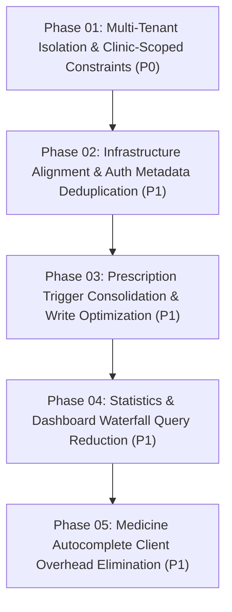

# Master Implementation Plan: QLPK-SaaS Performance & Security Hardening (P0 & P1)

**Plan Directory:** `plans/20261102-p0-p1-performance-hardening`  
**Created:** 2026-11-02  
**Target Vulnerabilities & Bottlenecks:** 2 Critical (P0), 5 High (P1)  
**Status:** ✅ Completed  

---

## 1. Executive Summary

This implementation plan resolves the top 7 mission-critical and high-impact performance and security vulnerabilities identified during the November 2026 codebase audit (`audit.11.2026.md`) and researched in `docs/BRIEF.md`.

The plan is divided into 5 focused, sequential phases. Each phase defines target objectives, strict functional and non-functional requirements, architectural constraints, dependencies, verifiable acceptance criteria, and exactly one comprehensive file-based test specification.

---

## 2. Issues Addressed

| ID | Severity | Category | Description | Phase |
| :--- | :--- | :--- | :--- | :--- |
| **PERF-001** | 🔴 Critical (P0) | Multi-Tenancy & RLS | Cross-tenant data leak in `get_patients_with_last_visit` missing tenant filtering | Phase 01 |
| **PERF-002** | 🔴 Critical (P0) | Data Integrity & Schema | Global unique index `idx_patients_unique_person` blocking cross-clinic patient registration | Phase 01 |
| **PERF-003** | 🟠 High (P1) | Infrastructure Latency | Network mismatch: Vercel functions deployed to `sin1` while Supabase runs in Seoul (`ap-northeast-2`) | Phase 02 |
| **PERF-004** | 🟠 High (P1) | Auth & Communication | N+1 database queries on `profiles` due to checking `user_metadata` instead of `app_metadata` | Phase 02 |
| **PERF-005** | 🟠 High (P1) | Database Concurrency | Write amplification and trigger storm on `clinic_daily_stats` during prescription creation | Phase 03 |
| **PERF-006** | 🟠 High (P1) | Data Flow & Latency | Network waterfall of 14 queries / 8 Server Actions on `/statistics` page load | Phase 04 |
| **PERF-007** | 🟠 High (P1) | Client Memory & Render | Loading 1,000 medicines on client and main-thread diacritic normalization lag | Phase 05 |

---

## 3. Phased Implementation Roadmap

---

## 4. Phase Index

| Phase | File | Primary Focus | Test Specification |
| :--- | :--- | :--- | :--- |
| **Phase 01** | [`phase-01-multi-tenant-isolation-p0.md`](./phase-01-multi-tenant-isolation-p0.md) | Enforce tenant boundaries in `get_patients_with_last_visit` and scope patient uniqueness to `clinic_id`. | `tests/phase-01-tenant-isolation.test.ts` |
| **Phase 02** | [`phase-02-infra-auth-deduplication-p1.md`](./phase-02-infra-auth-deduplication-p1.md) | Set Vercel region to `icn1` and eliminate N+1 `profiles` table queries via `app_metadata`. | `tests/phase-02-infra-auth.test.ts` |
| **Phase 03** | [`phase-03-prescription-trigger-consolidation-p1.md`](./phase-03-prescription-trigger-consolidation-p1.md) | Consolidate prescription trigger cascade and batch daily stats updates. | `tests/phase-03-prescription-triggers.test.ts` |
| **Phase 04** | [`phase-04-statistics-waterfall-reduction-p1.md`](./phase-04-statistics-waterfall-reduction-p1.md) | Eliminate 14-query waterfall on `/statistics` with consolidated retrieval. | `tests/phase-04-statistics-waterfall.test.ts` |
| **Phase 05** | [`phase-05-medicine-autocomplete-optimization-p1.md`](./phase-05-medicine-autocomplete-optimization-p1.md) | Replace 1,000-item client-side load with debounced server search & offload main-thread diacritic parsing. | `tests/phase-05-medicine-autocomplete.test.ts` |

---

## 5. Execution Rules for Coding Agents

1. **Strictly Phased:** Complete each phase sequentially. Do not start a subsequent phase until the current phase passes its acceptance criteria.
2. **Preserve Business Logic & Security:** Never weaken multi-tenant RLS, role-based access, audit logging, or financial calculation formulas.
3. **Evidence-Based Verification:** Every phase must be accompanied by execution of its dedicated file-based test suite.

